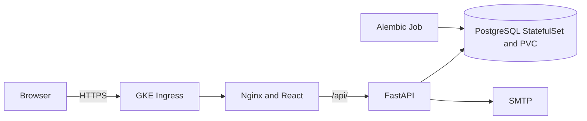

# DailyFlow DevOps Architecture

DailyFlow demonstrates how a containerized application moves from a Git change to a deployed service backed by PostgreSQL. This document describes the local environment, the CI/CD pipeline, the infrastructure on Google Kubernetes Engine (GKE), and the resources managed with Terraform.

## Environments and build artifacts

| Environment | What runs | Where data lives |
| --- | --- | --- |
| Local | Docker Compose with PostgreSQL 17, a one-off Alembic migration container, FastAPI, Nginx, and Mailpit. Host ports 3000, 8000, and 8025 bind to loopback. | The `postgres_data` volume stores the database. The `alembic_version` table tracks the schema revision. |
| CI | GitHub-hosted runners use Node.js 22, Python 3.12, and a temporary PostgreSQL service. Docker Buildx starts after the frontend build and backend tests pass. | The separate `calendar_test` database exists for the duration of the job. |
| Rollback drill | A manually triggered workflow creates a kind cluster, builds two variants of the frontend, and runs a stub health service. | The workflow uses a temporary cluster with test data. |
| Production | GKE in `europe-west3-a`, the `task-calendar` namespace, images from GHCR, and a public HTTPS ingress. | PostgreSQL uses a StatefulSet with a 5 GiB `standard-rwo` persistent volume with `ReadWriteOnce` access. |

The frontend image uses a multi-stage build. Node.js 22 produces static assets, and Nginx serves them. The backend image contains Python 3.12, Uvicorn, and Alembic, so the API and its migration job can use the same release image. [Compose](../compose.yaml) · [Frontend Dockerfile](../frontend/Dockerfile) · [Backend Dockerfile](../backend/Dockerfile)

## GKE traffic flow

Ingress routes traffic to the frontend using a managed TLS certificate. Nginx serves React and proxies API requests to FastAPI. PostgreSQL runs as a single-replica StatefulSet with persistent storage. The backend also has one replica and uses the `Recreate` strategy, so deployment can briefly interrupt service. [Ingress](../infrastructure/kubernetes/ingress.yaml) · [Nginx configuration](../frontend/nginx.conf) · [Backend](../infrastructure/kubernetes/backend.yaml) · [PostgreSQL](../infrastructure/kubernetes/postgres.yaml)

### Kubernetes resources and deployment prerequisites

- The Ingress routes to `frontend-https`, a NodePort Service. The frontend manifest also declares a separate `frontend` ClusterIP Service. `backend` is an internal ClusterIP Service, and PostgreSQL uses a headless Service.
- `FrontendConfig` redirects HTTP to HTTPS. The Ingress references a reserved global IP and a `ManagedCertificate`. DNS must point the application domain to that IP. [FrontendConfig](../infrastructure/kubernetes/frontend-config.yaml) · [Certificate](../infrastructure/kubernetes/managed-certificate.yaml)
- The frontend checks readiness on `/`. The backend uses `/health`, which checks database connectivity, for both readiness and liveness. PostgreSQL uses `pg_isready`. The manifests define resource requests and limits.
- `ghcr-secret` authorizes image pulls, `backend-secret` supplies the database URL, `postgres-secret` supplies PostgreSQL's initialization password, and `dailyflow-smtp` supplies SMTP configuration. The repository contains Secret references. Production sets `APP_BASE_URL` and `ALLOWED_ORIGINS` to the application domain.
- Workload Identity Federation gives GitHub Actions short-lived Google Cloud credentials. Kubernetes Roles and RoleBindings control what the deployer can do in the namespace. The cluster, DNS, deployment identity, pull credentials, and SMTP configuration must be in place before CD runs. [CD workflow](../.github/workflows/cd.yml) · [Kubernetes RBAC](../infrastructure/kubernetes/github-actions-rbac.yaml) · [Workload Identity Federation](https://docs.cloud.google.com/iam/docs/workload-identity-federation-with-deployment-pipelines)

## Infrastructure as code with Terraform

The Google Cloud configuration in [`infrastructure/backup/gcp`](../infrastructure/backup/gcp) manages four resources:

| Terraform resource | Purpose |
| --- | --- |
| `google_storage_bucket.backups` | Private Cloud Storage bucket with public access prevention, a 30-day object lifecycle rule for PostgreSQL dumps, and seven-day soft delete. |
| `google_storage_bucket_iam_member.backup_writer` | Grants the backup workload object-creation access to that bucket through Workload Identity Federation for GKE. |
| `google_logging_metric.backup_success` | Counts messages that confirm a successful upload to Cloud Storage. |
| `google_monitoring_alert_policy.stale_backup` | Detects when no successful backup signal has appeared in the past 20 hours. It can send notifications through an existing Cloud Monitoring channel. |

The [Kubernetes CronJob](../infrastructure/backup/cronjob.yaml) runs separately and sends PostgreSQL dumps to the bucket every 12 hours. Kubernetes manifests manage the workload and its ServiceAccount. The current Terraform configuration covers the cloud resources shown above. The GKE cluster, node pools, Kubernetes workloads, and email notification channel are provisioned separately. The local Docker setup runs independently of Terraform.

## From commit to deployment

1. CI builds the frontend and runs backend tests on pull requests and pushes to `main`. It applies Alembic migrations to a temporary PostgreSQL database before running pytest. Once the checks pass, CI builds the container images. A push to `main` publishes the application images to GHCR using both the commit SHA and `latest`, and the backup image using the commit SHA. [CI workflow](../.github/workflows/ci.yml)
2. CD starts after successful CI for a push to `main` in this repository. It verifies that the SHA still points to the current tip of `main` and serializes deployments. GitHub Actions uses OIDC and Workload Identity Federation for Google Cloud access. Kubernetes RBAC limits its permissions in the namespace. [CD workflow](../.github/workflows/cd.yml) · [RBAC](../infrastructure/kubernetes/github-actions-rbac.yaml)
3. An Alembic Job runs using the same backend image SHA as the Deployment. A failed migration stops the release. After a successful migration, CD applies the backend manifest, updates the frontend image, and checks both rollouts. An HTTPS smoke test requires HTTP 200 and the React root element on the home page, plus a `{"status": "ok"}` JSON response from `/health`. A failed smoke test marks the workflow as failed. [Migration Job](../infrastructure/kubernetes/alembic-migration-job.yaml) · [Smoke test](../scripts/smoke-test.sh)

### Release identifiers

The image tag identifies the Git commit used to build the image. The Alembic revision identifies the schema installed in the database. The repository currently has six migrations ending at `4582f8f7e37e`. The GKE migration Job has a 300-second deadline, no automatic retries, and a 24-hour TTL after completion. [Migration revisions](../backend/migrations/versions) · [Job manifest](../infrastructure/kubernetes/alembic-migration-job.yaml)

The `alembic-initial-stamp` manifest records the one-time bootstrap of an existing database. Alembic `stamp` records a revision without executing schema changes, so the existing schema must already match that revision. An empty database uses `upgrade head`. [Historical bootstrap Job](../infrastructure/kubernetes/alembic-stamp-job.yaml)

### Verified deployment

On November 27, 2026, a verified release passed CI and CD, including the migration Job, both rollouts, and the **Smoke test through public HTTPS** step. [GitHub Actions](https://github.com/greeegoryy/task-calendar/actions)

## Rollback drill in kind

Run [DailyFlow rollback drill](../.github/workflows/rollback-drill.yml) manually from the **Actions** tab. It creates a temporary kind cluster on a GitHub runner, builds the actual frontend image, and uses a test backend to serve `/health`.

1. Deploy a working frontend image and verify it with the same smoke-test script used by CD.
2. Deploy a variant whose Nginx configuration returns HTTP 503 for `/health`. The rollout completes, and the smoke test detects the failure.
3. Run `kubectl rollout undo`, confirm which image was restored, and repeat the smoke test. The workflow summary records the time between starting the rollback and passing the test.

The drill exercises frontend rollback. Rolling back the backend after a migration requires a separate PostgreSQL schema-compatibility check. In production, a failed smoke test reports the failure, and the operator decides whether to roll back.

### Local verification

On November 26, 2026, the working frontend passed the smoke test. The faulty variant completed its rollout but returned HTTP 503 on `/health`. The previous image passed the smoke test **4 seconds** after rollback started in one local kind drill.

A separate Compose run with a fresh PostgreSQL 17 database passed all six Alembic migrations, 42 pytest tests, and the Nginx smoke test. The local walkthrough also covered registration, Mailpit delivery, account activation, sign-in, task creation and deletion, and sign-out.
