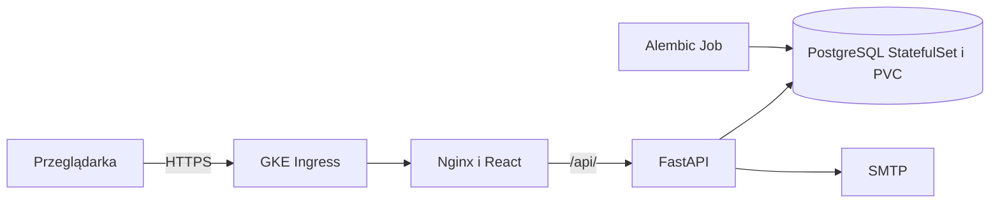

# Architektura i historia DevOps

DailyFlow pozwala pokazać pełny cykl dostarczania aplikacji z bazą danych. Repozytorium zawiera lokalny Compose, pipeline CI/CD, Dockerfile obu komponentów oraz manifesty GKE. Poniższy opis pokazuje przepływ ruchu przez klaster oraz drogę od zmiany w Git do publicznego smoke testu.

## Środowiska i artefakty

| Środowisko | Co działa | Jak dane są przechowywane |
| --- | --- | --- |
| Lokalne | Docker Compose z PostgreSQL 17, jednorazową migracją Alembic, FastAPI, Nginx oraz Mailpit. Porty hosta 3000, 8000 i 8025 są przypięte do loopback. | Wolumen `postgres_data`. Stan migracji zapisuje tabela `alembic_version`. |
| CI | GitHub-hosted runner, Node 22, Python 3.12 i tymczasowy PostgreSQL. Build frontendu i testy API są niezależnymi zadaniami, a Docker Buildx startuje po obu. | Oddzielna baza `calendar_test` żyje przez czas joba. |
| Ćwiczenie rollbacku | Workflow ręczny tworzy klaster kind, buduje rzeczywisty frontend w dwóch wariantach i uruchamia zastępczy serwis health. | Tymczasowy klaster bez produkcyjnych danych. |
| Produkcyjne | GKE w `europe-west3-a`, namespace `task-calendar`, obrazy z GHCR i publiczny Ingress HTTPS. | StatefulSet PostgreSQL, 5 GiB `standard-rwo` z dostępem ReadWriteOnce. |

Obraz frontendu powstaje w dwóch etapach. Node 22 buduje artefakt statyczny, a Nginx jest środowiskiem uruchomieniowym. Obraz backendu zawiera Pythona 3.12, Uvicorn i Alembic. Dzięki temu migracja i API z danego wydania mogą używać tego samego obrazu. [Compose](../compose.yaml) · [Dockerfile frontendu](../frontend/Dockerfile) · [Dockerfile backendu](../backend/Dockerfile)

## Architektura na GKE

Ingress kieruje ruch do serwisu frontendu i korzysta z zarządzanego certyfikatu. Nginx serwuje React i przekazuje żądania API do backendu. PostgreSQL pracuje jako jednoreplikowy StatefulSet z trwałym wolumenem. Backend ma jedną replikę i strategię `Recreate`, więc podczas wymiany poda może wystąpić przerwa. [Ingress](../infrastructure/kubernetes/ingress.yaml) · [Nginx](../frontend/nginx.conf) · [Backend](../infrastructure/kubernetes/backend.yaml) · [PostgreSQL](../infrastructure/kubernetes/postgres.yaml)

### Zasoby i zależności wdrożenia

- `frontend-https` to Service typu NodePort używany przez Ingress. Manifest Deploymentu frontendu deklaruje również osobny Service `frontend` typu ClusterIP. `backend` jest wewnętrznym Service typu ClusterIP. PostgreSQL ma Service bez adresu ClusterIP, powiązany ze StatefulSetem.
- `FrontendConfig` włącza przekierowanie HTTP → HTTPS. Ingress odwołuje się do wcześniej zarezerwowanego globalnego IP i do `ManagedCertificate`. DNS musi kierować domenę na właściwy adres. [FrontendConfig](../infrastructure/kubernetes/frontend-config.yaml) · [Certyfikat](../infrastructure/kubernetes/managed-certificate.yaml)
- Frontend ma sondę readiness na `/`. Backend ma readiness i liveness na `/health`, który sprawdza połączenie z bazą. PostgreSQL używa `pg_isready`. Manifesty zawierają requests i limits zasobów. Nie jest to wdrożenie wysokiej dostępności.
- `ghcr-secret` służy do pull obrazów, `backend-secret` przekazuje URL bazy, `postgres-secret` hasło PostgreSQL, a `dailyflow-smtp` konfigurację dostępu do SMTP. Repo zawiera referencje do Secretów. Produkcyjne `APP_BASE_URL` i `ALLOWED_ORIGINS` są ustawione na domenę aplikacji.
- WIF w GCP odpowiada za zaufanie i uzyskanie krótkotrwałych danych dostępowych. Role i RoleBinding w Kubernetes kontrolują działania konta wdrożeniowego wewnątrz namespace. Warunki providera WIF, uprawnienia IAM, DNS, klaster, pull secrets i dane SMTP stanowią zależności bootstrapu. Samo CD zakłada, że istnieją. Repozytorium nie zawiera kompletnego Terraformu odtwarzającego te zależności. [Workflow CD](../.github/workflows/cd.yml) · [Kubernetes RBAC](../infrastructure/kubernetes/github-actions-rbac.yaml) · [WIF](https://docs.cloud.google.com/iam/docs/workload-identity-federation-with-deployment-pipelines)

## Od commita do wdrożenia

1. CI na pull requeście lub pushu do `main` buduje frontend i uruchamia testy backendu. PostgreSQL jest usługą testową, a Alembic aktualizuje schemat przed uruchomieniem pytest. Po tych kontrolach CI buduje obrazy. Push do `main` publikuje obrazy aplikacji w GHCR pod tagiem SHA commita i `latest`. [Workflow CI](../.github/workflows/ci.yml)
2. CD reaguje na udane CI dla pushu do `main` w tym repozytorium. Sprawdza, czy SHA nadal wskazuje aktualny `main`, i serializuje wdrożenia. GitHub Actions uwierzytelnia się do GCP przez OIDC i Workload Identity Federation, a dostęp do zasobów w namespace `task-calendar` opisuje RBAC. [Workflow CD](../.github/workflows/cd.yml) · [RBAC](../infrastructure/kubernetes/github-actions-rbac.yaml)
3. Job Alembic używa obrazu backendu z tym samym SHA, którego użyje Deployment. Nieudana migracja zatrzymuje dalsze wdrożenie. Po udanej migracji CD stosuje manifest backendu, aktualizuje obraz frontendu i sprawdza rollout obu komponentów. Na końcu smoke test przez publiczny HTTPS sprawdza kod HTTP 200 i znacznik Reacta na stronie głównej oraz odpowiedź JSON `{"status": "ok"}` na `/health`. Nieudany smoke test kończy workflow błędem. Ten przebieg zakłada wcześniej przygotowane zasoby klastra, w tym Deploymenty, bazę i sekrety. [Job migracji](../infrastructure/kubernetes/alembic-migration-job.yaml) · [Workflow CD](../.github/workflows/cd.yml)

### Dwa niezależne identyfikatory wydania

SHA commita jest tagiem obrazu i odpowiada na pytanie „jaki kod budowano”. Rewizja Alembic odpowiada na pytanie „jaki schemat jest w bazie”. W repo końcowa rewizja to `4582f8f7e37e`, a łańcuch obejmuje sześć migracji. Job w GKE ma limit 300 s, brak automatycznych ponowień i TTL 24 h po zakończeniu. CD czeka na jego powodzenie przed rolloutem backendu. [Migracje](../backend/migrations/versions) · [Job](../infrastructure/kubernetes/alembic-migration-job.yaml)

Manifest `alembic-initial-stamp` to ślad jednorazowego bootstrapu historycznej bazy. `stamp` zapisuje numer rewizji bez wykonania DDL. Przed użyciem na istniejącej bazie trzeba potwierdzić zgodność schematu z rewizją. Standardowa ścieżka na pustej bazie używa `upgrade head`. [Historyczny Job](../infrastructure/kubernetes/alembic-stamp-job.yaml)

### Ostatnie zweryfikowane wydanie

27 listopada 2026 r. zweryfikowane wydanie przeszło CI i CD. W CD zakończyły się pomyślnie Job migracji, oba rollouty i krok **Smoke test through public HTTPS**. [GitHub Actions](https://github.com/greeegoryy/task-calendar/actions)

## Próba rollbacku na kind

Workflow [DailyFlow rollback drill](../.github/workflows/rollback-drill.yml) można uruchomić z zakładki **Actions** po dodaniu go do domyślnej gałęzi. Tworzy tymczasowy klaster kind na runnerze GitHub i buduje rzeczywisty obraz frontendu. Prostą odpowiedź `/health` dostarcza testowy backend.

1. Workflow uruchamia poprawny obraz i sprawdza go skryptem używanym przez CD.
2. Wdraża wariant obrazu, w którym Nginx zwraca HTTP 503 dla `/health`. Rollout musi się zakończyć, a smoke test musi wykryć błąd HTTP.
3. Uruchamia `kubectl rollout undo`, sprawdza docelowy obraz i powtarza smoke test. Podsumowanie przebiegu podaje czas od rozpoczęcia cofania do ponownego zaliczenia testu.

Ćwiczenie obejmuje cofnięcie frontendu i wykrycie błędu, który przeszedł rollout. Cofnięcie backendu po migracji wymaga osobnego scenariusza z PostgreSQL i sprawdzeniem zgodności schematu. Produkcyjny smoke test zgłasza awarię bez automatycznego cofania wydania.

### Wynik próby lokalnej

26 listopada 2026 r. poprawny obraz frontendu zaliczył smoke test. Wariant zwracający HTTP 503 dla `/health` przeszedł rollout, ale oblał smoke test. Polecenie `kubectl rollout undo` przywróciło poprzedni obraz, a smoke test zaliczył się ponownie po **4 s** od rozpoczęcia cofania. Pomiar dotyczy pojedynczej próby na lokalnym kind.

Osobno uruchomiono Compose na świeżym PostgreSQL 17. Przeszło wszystkich sześć migracji Alembic, 42 testy pytest i smoke test przez Nginx. Sprawdzono też rejestrację, odbiór wiadomości w Mailpit, aktywację, logowanie, utworzenie i usunięcie zadania oraz wylogowanie.
