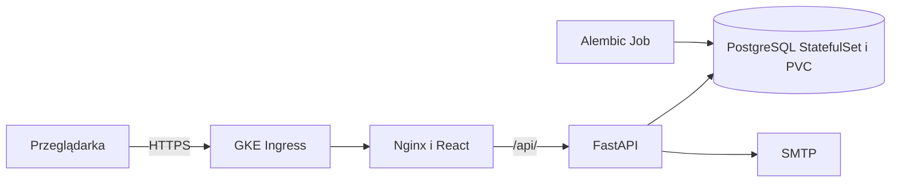

# Architektura i plan DevOps

DailyFlow pozwala pokazać pełny cykl dostarczania aplikacji z bazą danych. Repozytorium zawiera lokalny Compose, pipeline CI/CD, Dockerfile obu komponentów oraz manifesty GKE. Najbliższy etap portfolio to demonstracja, że po każdym wdrożeniu da się sprawdzić usługę, a po awarii odzyskać dane i ruch użytkowników.

## Architektura na GKE



Ingress kieruje ruch do serwisu frontendu i korzysta z zarządzanego certyfikatu. Nginx serwuje React i przekazuje żądania API do backendu. PostgreSQL pracuje jako jednoreplikowy StatefulSet z trwałym wolumenem. Backend ma jedną replikę i strategię `Recreate`, więc podczas wymiany poda może wystąpić przerwa. [Ingress](../infrastructure/kubernetes/ingress.yaml) · [Nginx](../frontend/nginx.conf) · [Backend](../infrastructure/kubernetes/backend.yaml) · [PostgreSQL](../infrastructure/kubernetes/postgres.yaml)

## Od commita do wdrożenia

1. CI na pull requeście lub pushu do `main` buduje frontend i uruchamia testy backendu. PostgreSQL jest usługą testową, a Alembic aktualizuje schemat przed uruchomieniem pytest. Po tych kontrolach CI buduje oba obrazy. Push do `main` publikuje w GHCR tag SHA commita i `latest`. [Workflow CI](../.github/workflows/ci.yml)
2. CD reaguje na udane CI dla pushu do `main` w tym repozytorium. Sprawdza, czy SHA nadal wskazuje aktualny `main`, i serializuje wdrożenia. GitHub Actions uwierzytelnia się do GCP przez OIDC i Workload Identity Federation, a dostęp do zasobów w namespace `task-calendar` opisuje RBAC. [Workflow CD](../.github/workflows/cd.yml) · [RBAC](../infrastructure/kubernetes/github-actions-rbac.yaml)
3. Job Alembic używa obrazu backendu z tym samym SHA, którego użyje Deployment. Nieudana migracja zatrzymuje dalsze wdrożenie. Po udanej migracji CD stosuje manifest backendu, aktualizuje obraz frontendu i sprawdza rollout obu komponentów. Na końcu smoke test przez publiczny HTTPS sprawdza kod HTTP 200 i znacznik Reacta na stronie głównej oraz odpowiedź JSON `{"status": "ok"}` na `/health`. Nieudany smoke test kończy workflow błędem. Ten przebieg zakłada wcześniej przygotowane zasoby klastra, w tym Deploymenty, bazę i sekrety. [Job migracji](../infrastructure/kubernetes/alembic-migration-job.yaml) · [Workflow CD](../.github/workflows/cd.yml)

## Diagnostyka wdrożenia

Uruchom poniższe polecenia z kontekstem właściwego klastra i uprawnieniami do odczytu w namespace `task-calendar`.

```bash
kubectl config current-context
kubectl -n task-calendar get deployment,pod,job,service,ingress
kubectl -n task-calendar rollout status deployment/backend --timeout=180s
kubectl -n task-calendar rollout status deployment/frontend --timeout=180s
kubectl -n task-calendar logs deployment/backend --tail=100
```

Jeśli migracja się nie powiedzie, nazwę Jobu znajdziesz w logu CD. Użyj `kubectl -n task-calendar describe job/<nazwa>` i `kubectl -n task-calendar logs job/<nazwa> --all-containers=true`. Przy nieudanym rolloucie porównaj tagi obrazów z SHA przebiegu CI i sprawdź zdarzenia podów. Cofnięcie obrazu aplikacji wymaga oceny zgodności poprzedniej wersji z aktualnym schematem bazy, ponieważ migracja odbywa się przed wymianą podów. [Workflow CD](../.github/workflows/cd.yml)

## Próba rollbacku na kind

Workflow [DailyFlow rollback drill](../.github/workflows/rollback-drill.yml) można uruchomić z zakładki **Actions** po dodaniu go do domyślnej gałęzi. Tworzy tymczasowy klaster kind na runnerze GitHub i buduje rzeczywisty obraz frontendu. Prostą odpowiedź `/health` dostarcza testowy backend.

1. Workflow uruchamia poprawny obraz i sprawdza go skryptem używanym przez CD.
2. Wdraża wariant obrazu, w którym Nginx zwraca HTTP 503 dla `/health`. Rollout musi się zakończyć, a smoke test musi wykryć błąd HTTP.
3. Uruchamia `kubectl rollout undo`, sprawdza docelowy obraz i powtarza smoke test. Podsumowanie przebiegu podaje czas od rozpoczęcia cofania do ponownego zaliczenia testu.

Ćwiczenie obejmuje cofnięcie frontendu i wykrycie błędu, który przeszedł rollout. Cofnięcie backendu po migracji wymaga osobnego scenariusza z PostgreSQL i sprawdzeniem zgodności schematu. Produkcyjny smoke test zgłasza awarię bez automatycznego cofania wydania.

### Wynik próby lokalnej

26 listopada 2026 r. poprawny obraz frontendu zaliczył smoke test. Wariant zwracający HTTP 503 dla `/health` przeszedł rollout, ale oblał smoke test. Polecenie `kubectl rollout undo` przywróciło poprzedni obraz, a smoke test zaliczył się ponownie po **4 s** od rozpoczęcia cofania. Pomiar dotyczy pojedynczej próby na lokalnym kind.

Osobno uruchomiono Compose na świeżym PostgreSQL 17. Przeszło wszystkich sześć migracji Alembic, 42 testy pytest i smoke test przez Nginx. Sprawdzono też rejestrację, odbiór wiadomości w Mailpit, aktywację, logowanie, utworzenie i usunięcie zadania oraz wylogowanie.

